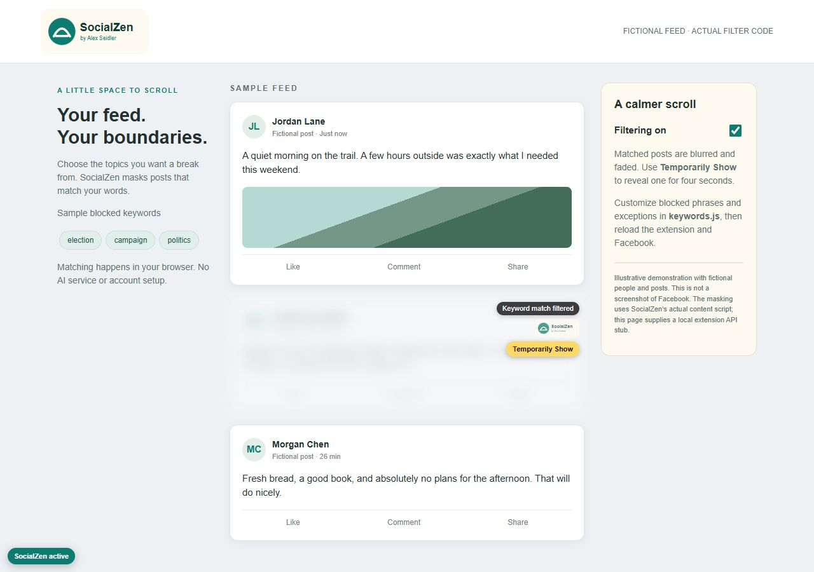

# SocialZen

I built SocialZen because I was tired of political posts taking over my Facebook feed. I wanted a way to choose the subjects I did not want to see and give myself a break from them.

SocialZen is a small browser extension that matches the words you choose and uses browser styling to blur, fade, and shorten those posts. The included list starts with politics and arguments, but you can replace it with any subjects you want to avoid.

[Project page](https://alexseidler.dev/work/socialzen/) | [Source](https://github.com/alexrgcdata/socialZen) | [Prerelease v1.0.3](https://github.com/alexrgcdata/socialZen/releases/tag/v1.0.3) | [Download ZIP](https://github.com/alexrgcdata/socialZen/releases/download/v1.0.3/socialzen-1.0.3.zip)

- **Available now:** v1.0.3 prerelease, installed manually in desktop Chrome or Edge. There is no browser-store release or keyword editor in the popup; you edit `keywords.js`.
- **Checked:** seven automated tests pass on the current source using fictional posts and a simulated extension API. The illustration below runs the actual masking code on a fictional feed.
- **Still unverified:** current signed-in Facebook coverage and installation as a native Chrome or Edge extension. The demo and tests do not establish those.

Version 1.0.3 includes the fix for a mask that could stick when a post changed to very short text. The earlier [v1.0.2 release](https://github.com/alexrgcdata/socialZen/releases/tag/v1.0.2), ZIP, and tag remain unchanged.



The image uses fictional people and posts. It is not a screenshot of Facebook.

## Install in Chrome or Edge

1. Download and extract the ZIP. Keep the extracted folder somewhere permanent.
2. Open `chrome://extensions` or `edge://extensions`.
3. Enable **Developer mode**, choose **Load unpacked**, and select the folder containing `manifest.json`.
4. Open or reload Facebook. Pin SocialZen to reach its on/off switch.

There is no build step, SocialZen account, API key, or subscription. This is a manual unpacked installation, not a Chrome Web Store release. The offline `installation-guide.html` has the same setup steps; keep its `assets` folder alongside it. The packaged extension targets desktop Chrome and Edge; Safari and mobile-browser installation are not supported by this package.

## Choose your keywords

Edit `keywords.js` in a text editor. For example:

```js
var BLOCK_KEYWORDS = ["election", "campaign", "spoiler"];
var OVERRIDE_KEYWORDS = ["community fundraiser"];
```

Replace the existing arrays rather than adding a second copy. Keep each phrase in quotes, separated by commas. Reload the extension on its extensions page, then reload Facebook. There is no keyword editor in the popup.

Matching ignores capitalization, repeated whitespace, and curly apostrophes. It uses substrings, not whole words or AI: `vote` also matches `devoted`. An override keeps the entire post visible even if a blocked term also appears. Broad keywords can mask posts you wanted to keep.

## How it works

The content script looks for Facebook post containers and checks their rendered text. Matching posts are blurred, faded, and shortened. **Temporarily Show** reveals a post for four seconds before the mask returns. The popup switch disables or enables filtering; its setting stays in `chrome.storage.local`.

A `MutationObserver`, the browser's page-change watcher, checks newly loaded and changed feed content after a short delay. Controls sit outside the blurred post so they remain readable. Filtering changes the page in your browser. It does not delete posts, unfollow people, or change your Facebook account.

## Privacy and limits

The extension code has no analytics, external API calls, or remote filtering service. Its only declared API permission is `storage`, with host access limited to the Facebook domains listed in `manifest.json`. The popup contains an ordinary link to rgcdata.com; opening it visits that website.

This is a text filter. It cannot understand context, recognize words inside images or video, or guarantee every post will be found. Facebook markup can change. The observer still rescans candidate posts across the page, so very long feeds may need performance work.

Version 1.0.2 passed five automated tests of simulated page elements and a browser demonstration using fictional posts and a simulated extension API. Version 1.0.3 adds two regression tests, for seven passing tests. Neither set establishes current coverage of a signed-in Facebook feed or a native Chrome/Edge installation. The screenshot is explicitly labeled as a fictional demonstration.

## Development checks

Node.js 20+ is used for development tests only:

```sh
npm ci
npm test
```

The seven tests use jsdom to simulate page elements. They cover normalized matching and override priority, substring matching and missing lists, new/changed/removed posts, reveal behavior across rescans, disabling during a reveal, unmasking shortened text, and disabling when a known post no longer meets the discovery rules. Tests shorten the four-second reveal timer to 650 ms; they check the state changes, not native browser timing or rendering. They do not test a real popup storage connection.

`demo/index.html` runs the actual content script against fictional feed markup using a small local Chrome API stub. If Python is available, serve the repository with:

```sh
python -m http.server 4198 --bind 127.0.0.1
```

Then open `http://127.0.0.1:4198/demo/`. The demo never connects to Facebook and does not exercise native extension installation or storage.

## Version 1.0.3 prerelease

A filtered post whose text changed below the scanner's 20-character minimum could keep its mask, even after filtering was switched off. The current source revisits already masked posts so changed text and the off switch can clear them. Two regression tests reproduce that case. This fix is included in the v1.0.3 prerelease ZIP. It is marked as a prerelease because native installation and signed-in Facebook acceptance remain unverified.

## Package a release

From a clean checkout with Python available, run `npm run package`. The script packages only its explicit public-file allow-list, verifies manifest resources and version agreement, and writes the ZIP, SHA-256, and a file-hash receipt under the ignored `release/` directory. It excludes installed dependencies and local/private files. No build or package installation is needed to load the resulting extension.

## Version 1.0.2

- Restored the missing extension icon and logo.
- Kept a temporary reveal open across feed rescans and hid its controls correctly.
- Removed controls and timers for detached posts; watched text changes as well as added posts.
- Removed broad fallback test words. A missing keyword file now leaves posts visible.
- Updated labels, documentation, and a fictional demo to explain configurable keyword filtering.

By [Alex Seidler](https://alexseidler.dev). No project-wide software license has been selected; public source access does not itself grant a reuse license.
